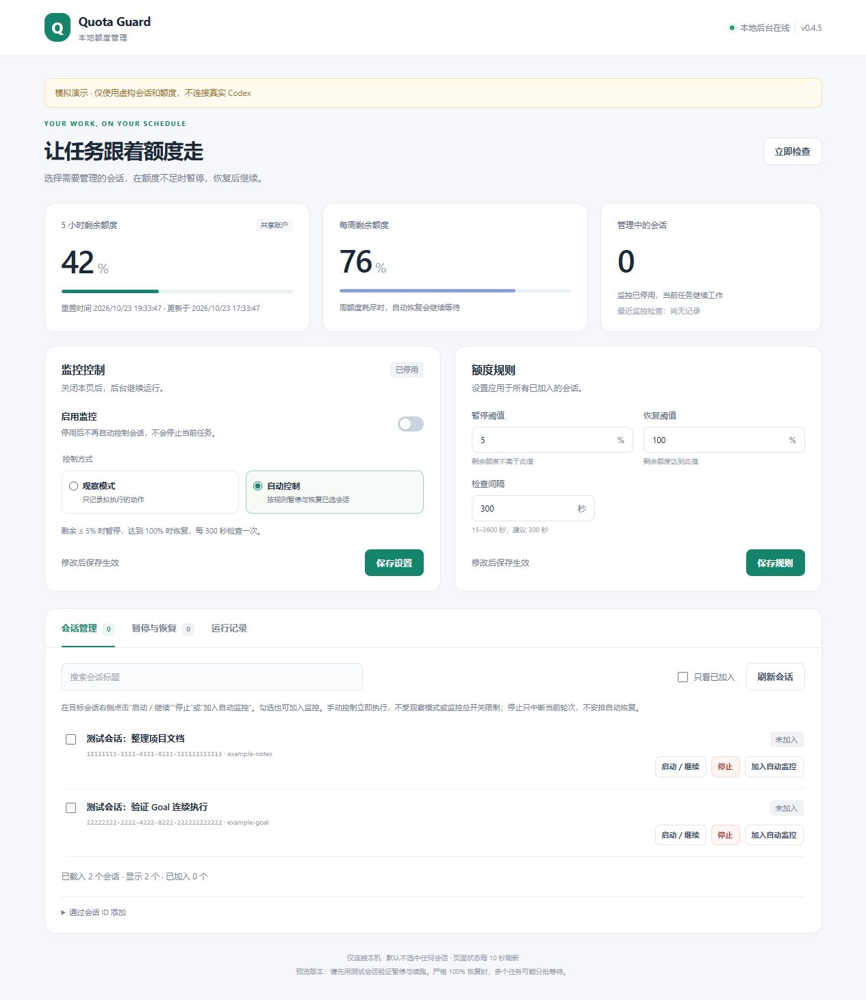

# Codex Quota Guard

**为 Windows／macOS Codex 桌面端选定的本地会话提供额度监控、暂停和续跑。**

作者：dingyang · MIT · 实验版 **0.4.6** · [English](README.en.md)

在浏览器管理页选择会话，配置剩余额度阈值，由本地后台定时判断是否中断当前轮次、是否提交续跑。无需让模型持续轮询额度。

> 适配 Windows 和特定版本的 macOS Apple Silicon 桌面本地会话，使用未公开的桌面接口。Mac 适配仍属实验支持，首次使用默认观察模式；普通 ChatGPT 网页聊天、云任务和 Linux 不在支持范围内。不是 OpenAI 官方项目。Mac 已验证条件触发控制和原 Goal 后续轮次，恢复条件使用隔离注入；未等待真实额度重置。先用测试会话验证。



截图使用模拟数据，不连接真实聊天。桌面中的原生 MCP Apps 面板是否显示取决于宿主。

## 功能

- 读取账户 5 小时及周额度，后台按可配置间隔检查。
- 仅管理你明确选中的会话，初始名单为空。
- 剩余额度不高于暂停阈值时，先记录会话和轮次，再中断该轮次。
- 满足恢复条件后，在原会话提交续跑；有 Goal 时尝试重新激活原 Goal。
- 手动启动／继续、停止、加入／移出自动监控。
- 保存监控设置、规则、恢复记录和事件；状态不明确时阻止自动重发。
- 提供浏览器管理页、MCP 工具、原生控制面板及命令行入口。

“暂停”是中断当前模型轮次，“恢复”是发送新的续跑消息，不是冻结并恢复进程快照。已经完成的文件修改、命令和外部操作不会回滚。

## 环境与安装

- Windows 或已验证版本的 macOS Apple Silicon，已登录且支持本地插件的 Codex 桌面端。
- Mac 请先阅读 [macOS 安装与验收](docs/MACOS.md)：使用桌面 IPC 读取实时状态，数据默认位于用户 Library。
- Node.js **22+**，`node` 和 `npm` 在 PATH 中，无 npm 运行依赖，无需 `npm install`。
- CLI／桌面端必须符合[兼容性说明](docs/COMPATIBILITY.md)。不保证任意新版可用。

下载源码 ZIP 并解压，进入包含 `package.json` 的目录，在 PowerShell 或 macOS 终端执行：

```powershell
node --version
npm run doctor
npm run package
npm run install:local
```

`doctor` 只读查询真实额度，输出保存在本机。安装会修改当前用户的 Codex 插件注册。按提示重新加载插件或重启桌面端，再在新聊天中使用插件。

Windows 源码安装默认把运行数据放在源码目录 `.runtime/user`；Mac 新安装默认使用 `~/Library/Application Support/Codex Quota Guard/`。请保留数据目录。已有安装升级时必须沿用原数据目录。**运行 ZIP 与源码 ZIP 的安装步骤不同**，详见[安装、升级与卸载](INSTALL.md)。

## 第一次使用

1. 在已加载插件的聊天中输入：**“使用 quota-guard 打开额度管理页。”**
2. 在“监控控制”选择启用状态和控制方式，点击 **保存设置**。想先验证时选择观察模式。
3. 在“额度规则”填写阈值和间隔，点击 **保存规则**。
4. 搜索目标会话，勾选或点击 **加入自动监控**。名单修改立即生效。
5. 在“暂停与恢复”和“运行记录”查看结果。

两个保存按钮均在后台确认后显示成功文字和约 3 秒的小提示；未保存的设置不会生效。会话名单和手动启动／停止不需要额外保存。

| 新数据目录默认设置 | 值 |
| --- | --- |
| 监控名单 | 空 |
| 控制方式 | Windows 自动控制；Mac 观察模式；均只处理明确加入的会话 |
| 监控开关 | 启用 |
| 暂停阈值 | 5 小时剩余额度 ≤ 5% |
| 恢复阈值 | 5 小时剩余额度 ≥ 100%，并满足周额度和任务身份等检查 |
| 后台检查间隔 | 300 秒，可设置 15–3600 秒 |
| 页面状态刷新 | 每 10 秒读取缓存，与后台额度检查不同 |

升级保留原设置。阈值表示**剩余百分比**，恢复阈值必须大于暂停阈值。页面打开／刷新会话时会读取真实额度。“立即检查”执行已保存规则，自动控制启用时可能立即中断或恢复已选会话。

## 手动控制与启停

| 操作 | 行为 |
| --- | --- |
| 启动／继续 | 空闲会话发送续跑；运行中不重复启动；符合条件时尝试激活原 Goal |
| 停止 | 中断当前轮次，不安排自动恢复，不结束整个 Codex 进程 |
| 加入／移出自动监控 | 修改名单；不立即发出手动启动或停止指令，后续按规则判断 |
| 观察模式 | 自动检查只记录拟执行动作 |
| 停用监控 | 停止自动管理，后台仍在，当前聊天任务继续 |
| 退出后台 | 保存监控为停用并结束后台；不停止当前聊天任务 |
| 关闭管理页 | 后台继续运行 |

**手动启动／停止在观察模式或监控停用时仍会执行。** 手动控制取消该会话未完成的旧自动恢复；会话仍在监控中时，后续轮次继续受额度规则约束。

在聊天中输入 **“显示 Quota Guard 控制面板”**，可通过支持的原生面板启用、停用、退出后台。宿主不显示面板时，可用[命令行](docs/USAGE.md#命令行)。禁用或卸载宿主插件连接前，先退出后台；两个开关不是同一个开关。

## 卸载

1. 先在 Quota Guard 控制面板点击 **退出后台**；也可按 [卸载说明](INSTALL.md#卸载)，使用原数据目录执行 `stop`，再通过 `service-status` 确认 `running:false`。
2. 在 Codex 桌面端插件管理中移除 Quota Guard。仅关闭管理页或禁用插件连接，不会可靠结束后台。
3. 运行数据默认保留。需要重装时保留原数据目录；确认不再需要配置、恢复记录和日志后，再删除数据目录与源码／安装包。完整步骤见 [安装与卸载说明](INSTALL.md#卸载)。

卸载不会自动继续已暂停的聊天，需要时在原聊天手动继续。

## 已知限制

- 采样存在延迟，不能保证恰好在 5% 时停止。
- 恢复逐个执行。严格要求 100% 时，首个会话消耗额度后，其余会话可能继续等待。
- 桌面端需运行并加载目标会话；关闭桌面、休眠或注销后不保证运行。没有托盘、Windows 服务、LaunchAgent 和开机启动项。
- 自动恢复仅处理本插件因额度中断的记录；账户、任务、Goal、轮次或排队输入变化会阻止或取消恢复。
- 续跑本身会消耗额度。额度耗尽、协议变化或结果不明确时可能需要手动处理。
- 本机 Mac 专用普通聊天已验证停止、续跑完成和请求去重；Windows 普通会话手动控制及一次自动暂停已有原开发环境反馈；**Mac 在受控恢复条件下的“暂停 → 自动恢复 → 原 Goal 后续轮次”已验收，未等待自然额度重置**。见[验证记录](docs/VALIDATION.md)。

## 文档

| 文档 | 内容 |
| --- | --- |
| [INSTALL.md](INSTALL.md) | 源码／运行包安装、升级、回退、卸载 |
| [使用手册](docs/USAGE.md) | 控制语义、恢复状态、CLI 和操作示例 |
| [常见问题](docs/TROUBLESHOOTING.md) | 阈值未停止、待恢复、离线、版本和数据目录问题 |
| [架构](docs/ARCHITECTURE.md) | 进程、通信、文件和数据流 |
| [Mac 安装与验收](docs/MACOS.md) | Mac 专用说明、环境变量及验收边界 |
| [兼容性](docs/COMPATIBILITY.md) | 精确版本组合和验证层级 |
| [隐私](docs/PRIVACY.md)／[安全](SECURITY.md) | 本地记录、访问凭证和问题报告 |
| [贡献指南](CONTRIBUTING.md)／[更新记录](CHANGELOG.md) | 开发和版本变化 |
| [Git 维护流程](docs/GIT_WORKFLOW.md) | 克隆、分支、提交、推送和日常更新 |
| [发布指南](docs/RELEASING.md) | 校验、打包、GitHub 发布及维护者步骤 |

## 开发

```powershell
npm run check
npm test
npm run demo
```

`demo` 返回仅使用模拟聊天的本机演示页链接，在终端按 Ctrl+C 退出。`check` 校验清单、版本、本地文档链接和常见敏感信息特征，不能代替人工隐私审阅。测试不控制真实聊天。Node.js 标准库实现后台；前端使用 HTML、CSS、原生 JavaScript。Python 3 仅用于维护者的 ZIP 校验和源码归档。

采用 [MIT](LICENSE)。设计参考及第三方说明见 [NOTICE.md](NOTICE.md)。作者 **dingyang**（GitHub：**DoubleYang168**）。仓库：[DoubleYang168/codex-quota-guard](https://github.com/DoubleYang168/codex-quota-guard)。GitHub 开源不代表已上架官方插件目录。
