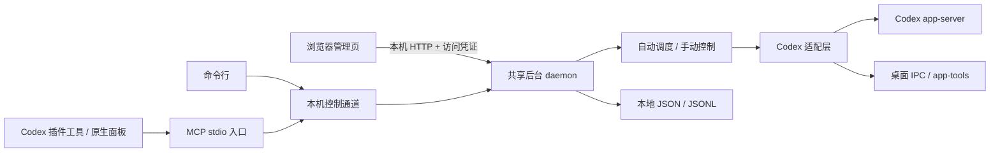

# 架构与数据流

项目使用 JavaScript ES Modules 和 Node.js 22+ 标准库，前端为 HTML／CSS／原生 JavaScript，无 npm 运行依赖。

## 模块

| 文件／目录 | 职责 |
| --- | --- |
| `bin/quota-guard.mjs` | CLI 分发入口，启动 daemon 或 MCP |
| `src/mcp.mjs`、`src/panel.mjs` | MCP 工具、原生面板资源 |
| `src/control.mjs`、`src/service.mjs` | 本机控制客户端和后台生命周期 |
| `src/daemon.mjs` | 单实例锁、控制服务、调度和管理页服务生命周期 |
| `src/dashboard.mjs` | 仅本机 HTTP、静态资源和 API 校验 |
| `src/engine.mjs` | 自动额度暂停、恢复、身份核对和重启恢复 |
| `src/manual-control.mjs` | 手动启动／停止、去重及结果不明处理 |
| `src/backend.mjs` | 组合额度读取、会话索引、实时状态及控制 |
| `src/app-server.mjs` | Codex app-server 子进程 JSON-RPC |
| `src/desktop-ipc.mjs`、`src/app-tools.mjs` | 未公开桌面接口适配 |
| `src/store.mjs`、`src/paths.mjs` | 配置验证、持久化、路径和控制通道 |
| `web/` | 管理页与原生 MCP Apps 面板的 HTML／CSS／JS |

MCP 入口由宿主启动；多个入口共享同一数据目录的一个后台。后台按需启动 app-server 子进程；浏览器 HTTP 服务在需要打开管理页时创建，属于后台进程，不是另一个独立前端服务器。不同数据目录意味着不同后台，不能让它们同时控制同一会话。

## 控制边界

会话索引和额度由 app-server 读取；桌面当前活动轮次由桌面实时接口核对，不能把单独 app-server 的历史状态当作桌面当前状态。中断使用精确会话／轮次身份；原 Goal 如需暂停或激活，也要经过前后状态核对。

自动恢复只处理插件自己的额度暂停记录。执行前重新检查账户、周额度、Goal、任务身份、轮次、队列等条件。控制意图先持久化；结果不明时转人工检查，避免重启后重复发续跑。手动与自动控制互斥。

## 数据与通信

- Windows 本机控制通道使用按数据目录派生名称的命名管道，带控制令牌。
- 管理页只监听 `127.0.0.1` 随机端口，使用随机凭证，验证 Host／Origin 和 API 参数。
- `state.json` 保存配置、监控名单、恢复和手动去重记录；`events.jsonl` 保存轮换事件日志。
- `control-token`、锁文件、页面链接与诊断文件仅留本机。文件未加密。
- 数据目录优先级：`CODEX_QUOTA_GUARD_HOME` → 当前安装根目录 `runtime-home.json` → 当前代码根目录 `.runtime`。

源码安装脚本默认把指针固定到源码目录 `.runtime/user`。不存在数据库、远端管理服务、模型轮询循环、托盘或 Windows 服务。续跑会发给 Codex，可能消耗订阅额度。

## 插件清单

`plugin.json`／`mcp.json` 是便携清单；`.codex-plugin/plugin.json`／`.mcp.json` 保留已验证的 Codex 兼容入口；`.agents/plugins/marketplace.json` 注册本地 marketplace。不要删除点开头的配置目录。

官方插件打包和本地 marketplace 机制见 [OpenAI Developers](https://developers.openai.com/plugins/build/plugins)。本项目的桌面私有 IPC 适配是独立实验实现，官方插件文档不为其兼容性提供保证。
